<div align="center">
  <!-- Waving Header Banner -->
  

  <br>

  <!-- Typing SVG -->
  <a href="https://git.io/typing-svg">
    
  </a>

  <br><br>

  <p>
    <a href="https://tansys.my.id/"></a>
    <a href="https://www.linkedin.com/in/fathan-mulyasa-h-599470371/"></a>
    <a href="mailto:hello@tansys.my.id"></a>
    <a href="https://github.com/itsxianzhing"></a>
    <a href="https://github.com/itsxianzhing"></a>
  </p>
</div>

<!-- Neon divider -->


<h3 align="center">
  <samp>Hi, I'm <b><a href="https://github.com/itsxianzhing">Fathan</a></b> 👾</samp>
</h3>
<p align="center">
  <samp>Turning operational bottlenecks into scalable, real-world products.</samp><br/>
  <samp>Current stack: <b>React · Next.js · Laravel · .NET · Node.js · PostgreSQL · Docker</b></samp>
</p>

<!-- Intro + GIF side by side (full width so it never gets cut off) -->
<table width="100%">
  <tr>
    <td width="58%" valign="top">
      <h4>About</h4>
      <ul>
        <li>💻 Full-Stack engineer who cares about clean architecture, sensible APIs and real user impact.</li>
        <li>🏗️ Enjoys modular design: <b>Feature-Sliced Design</b> on the frontend, <b>Multi-Tenant SaaS</b> on the backend.</li>
        <li>🤖 AI-augmented workflow with Cursor, OpenClaw and Claude, with full control over core design decisions.</li>
        <li>🎯 Open to Full-Stack / Frontend / Backend roles.</li>
        <li>✉️ Reach me: <a href="mailto:hello@tansys.my.id">hello@tansys.my.id</a></li>
      </ul>
    </td>
    <td width="42%" align="center" valign="middle">
      
    </td>
  </tr>
</table>

<!-- Neon divider -->


### 🧠 Mindset & Engineering Approach

I believe **software engineering goes beyond typing code**—it's about deeply understanding operational bottlenecks, user needs, and engineering scalable digital solutions that drive real value.

* 🎯 **Current Focus:** Actively seeking job opportunities (Full-Stack / Frontend / Backend) while developing personal product initiatives to continuously sharpen my technical execution.
* 🏗️ **Architecture & Clean Code:** Implementing modular architectures like **Feature-Sliced Design (FSD)** on the frontend and **Multi-Tenant SaaS** patterns on the backend for long-term scalability and maintainability.
* 🤖 **AI-Augmented Workflow:** Leveraging AI tools and gateways (Cursor, OpenClaw, Claude) to accelerate development iterations while maintaining strict control over core system mechanics and design decisions.

<!-- Terminal-style snapshot -->
```bash
$ whoami
Fathan Mulyasa H. — Full-Stack Engineer | Product-Minded Builder

$ status --check
[ACTIVE]    open to Full-Stack / Frontend / Backend roles
[BUILDING]  SIPA, SVMS & AI Personal OS — sharpening execution between opportunities

$ cat philosophy.txt
Engineering isn't just about writing code — it's about understanding
operational bottlenecks and shipping solutions that create real value.

$ contact --email
hello@tansys.my.id
```

<!-- Neon divider -->


### 🛠️ Tech Stack & Ecosystem

<div align="center">
  <a href="https://skillicons.dev">
    
  </a>
</div>

<br>

<div align="center">


</div>

<table width="100%">
  <tr>
    <th align="left" width="28%">Domain</th>
    <th align="left" width="72%">Technologies & Tools</th>
  </tr>
  <tr>
    <td><b>Frontend & Mobile</b></td>
    <td>React, Next.js, HTML5, CSS3, Tailwind CSS, GSAP</td>
  </tr>
  <tr>
    <td><b>Backend & API</b></td>
    <td>Laravel, .NET (C#), Node.js, RESTful API, Swagger</td>
  </tr>
  <tr>
    <td><b>Database & DevOps</b></td>
    <td>PostgreSQL, MySQL, Supabase, Prisma, Docker, Nginx Proxy Manager, Cloudflare, Git, Vercel</td>
  </tr>
  <tr>
    <td><b>AI & Developer Tools</b></td>
    <td>Cursor AI, Codex, OpenClaw, Claude, n8n, Postman</td>
  </tr>
</table>

<!-- Neon divider -->


### 🚀 Featured Projects at a Glance

<table width="100%">
  <tr>
    <td width="50%" valign="top">
      <b><a href="https://loan.tansys.my.id">🛠️ SIPA</a></b><br/>
      Equipment loan information system with stock locking, photo verification and automated overdue tracking.<br/>
      <sub><i>Laravel · Cloudflare R2 · Render</i></sub>
    </td>
    <td width="50%" valign="top">
      <b>🏟️ SVMS</b><br/>
      Multi-tenant SaaS for sports venue operations: booking, payments, reviews and analytics.<br/>
      <sub><i>Multi-Tenant SaaS · Subscription + Transaction Fees</i></sub>
    </td>
  </tr>
  <tr>
    <td width="50%" valign="top">
      <b><a href="https://helpdesk.tansys.my.id">🎫 Helpdesk System</a></b><br/>
      Full-stack ticketing platform with JWT auth, role-based access and real-time notifications.<br/>
      <sub><i>.NET · SignalR · Supabase · Docker</i></sub>
    </td>
    <td width="50%" valign="top">
      <b>🤖 AI Personal OS</b><br/>
      Telegram-based proactive AI assistant with persistent context and GitHub-aware planning.<br/>
      <sub><i>.NET · PostgreSQL · n8n · OpenRouter</i></sub>
    </td>
  </tr>
</table>

### 🔍 Featured Case Studies (Problem-Solving in Action)

<details open>
<summary><b>1. 🛠️ SIPA — Equipment Loan Information System</b></summary>

> **Competency Exam Status:** Highly Competent | [Live Demo](https://loan.tansys.my.id)

* **Problem Statement:** Conventional physical inventory management suffers from stock discrepancies (*double-booking*), unverified disputes over item condition during handovers, and untracked overdue returns.
* **Product & Technical Solutions:**
  * **Automated Stock Locking:** The system locks remaining inventory during request placement and performs real-time stock deduction upon physical handover.
  * **Photo Verification (Before/After):** Enforces photo documentation uploads during handover and return phases to eliminate item condition disputes.
  * **Automated Overdue Detection:** Built a background task scheduler (`php artisan schedule:work`) to track return deadlines and calculate late fees automatically.
  * **DevOps Resilience Pivot:** Resolved VPS infrastructure failures by migrating asset storage to Cloudflare R2 and compute services to Render, paired with SSL termination handling behind reverse proxies.

</details>

<details>
<summary><b>2. 🏟️ SVMS — Sports Venue Management System</b></summary>

> **Multi-Tenant SaaS Platform** for Sports Facility Operations

* **Problem Statement:** Sports venue businesses in Indonesia rely heavily on manual WhatsApp messaging and spreadsheets. This leads to schedule collisions, inefficient manual payment verification, and a total lack of actionable business analytics.
* **Product & Technical Solutions:**
  * **Multi-Tenant Architecture:** Strict data isolation between venue owners within a centralized platform ecosystem, using business-membership-based authorization.
  * **End-to-End Booking Lifecycle:** Integrated venue discovery, real-time interactive scheduling, automated payment workflows, and customer review systems.
  * **Hybrid Monetization Model:** Engineered around recurring subscriptions and transactional fees to ensure sustainable platform revenue.

</details>

<details>
<summary><b>3. 🎫 Helpdesk System — Full-Stack Ticket Management Platform</b></summary>

> **Production Demo:** [helpdesk.tansys.my.id](https://helpdesk.tansys.my.id)

* **Problem Statement:** Internal support requests often become difficult to track when communication is scattered across informal channels. A centralized ticket-based workflow is needed to manage requests, ownership, status, communication, and administrative oversight.
* **Product & Technical Solutions:**
  * **End-to-End Ticket Workflow:** Built a complete support workflow covering ticket creation, status and priority management, comments, ticket history, and administrative operations.
  * **Secure Authentication & Authorization:** Implemented JWT authentication with refresh tokens, BCrypt password hashing, role-based authorization, protected routes, and separate Admin/User capabilities.
  * **Real-Time Notifications:** Integrated **ASP.NET Core SignalR** to deliver ticket activity notifications in real time without requiring page refreshes.
  * **Data Integrity & Concurrency:** Implemented audit fields, soft deletion, optimistic concurrency, pagination, filtering, sorting, and database-side timestamps to improve reliability as the system grows.
  * **Production Deployment:** Deployed the complete full-stack application using Docker, Nginx Proxy Manager, Cloudflare Tunnel, Cloudflare, and Supabase PostgreSQL.

</details>

<details>
<summary><b>4. 🤖 AI Personal OS — Proactive AI Productivity Assistant</b></summary>

> **Telegram-Based Personal Productivity System** powered by AI, automation, and persistent context

* **Problem Statement:** Personal productivity is fragmented across calendars, notes, task managers, GitHub, reminders, and chat applications. AI Personal OS aims to provide a single interface that understands ongoing context and proactively helps plan, track, and review daily work.
* **Product & Technical Solutions:**
  * **Proactive Daily Planning:** Built scheduled morning, afternoon, and evening flows that review previous logs, unfinished tasks, GitHub activity, progress, and blockers to continuously guide daily execution.
  * **Persistent Context:** Implemented daily logs, task/project tracking, message history, and short-term memory so the assistant can maintain context across interactions and days.
  * **GitHub Integration:** Connected GitHub activity directly into the productivity workflow, allowing recent commits and selected repositories to become part of the assistant's planning context.
  * **AI Persona & Interaction Layer:** Designed **Aya**, a dedicated AI persona with a casual conversational style and principles focused on honesty, productivity, and practical guidance.
  * **Automation-Oriented Architecture:** Combined Telegram webhooks, a .NET Web API, PostgreSQL, OpenRouter, GitHub API, and n8n scheduled workflows into a single personal productivity system.
  * **Agent-Ready Foundation:** Designed the system around a shared memory and reasoning layer so future domains such as learning, career, finance, and other personal workflows can be added incrementally.

</details>

<!-- Section divider GIF -->
<div align="center">
  <br/>
  
  <br/><br/>
</div>

<!-- Neon divider -->


### 📊 GitHub Analytics

<div align="center">

<table width="100%">
<tr>
<td align="center" width="50%"></td>
<td align="center" width="50%"></td>
</tr>
</table>


<br><br>

<!-- Contribution graph (neon) -->


<br>

<!-- Trophy case -->


</div>

<br>

### 🐍 Contribution Snake

<div align="center">
  <picture>
    <source media="(prefers-color-scheme: dark)" srcset="https://raw.githubusercontent.com/itsxianzhing/itsxianzhing/output/snake-dark.svg" />
    <source media="(prefers-color-scheme: light)" srcset="https://raw.githubusercontent.com/itsxianzhing/itsxianzhing/output/snake.svg" />
    
  </picture>
</div>

### 👾 Contribution Pac-Man

<div align="center">
  <picture>
    <source media="(prefers-color-scheme: dark)" srcset="https://raw.githubusercontent.com/itsxianzhing/itsxianzhing/output/pacman-contribution-graph-dark.svg" />
    <source media="(prefers-color-scheme: light)" srcset="https://raw.githubusercontent.com/itsxianzhing/itsxianzhing/output/pacman-contribution-graph.svg" />
    
  </picture>
</div>

<!-- Neon divider -->


### 🤝 Let's Connect

<div align="center">
  
</div>

<br>

<p align="center">
  <a href="mailto:hello@tansys.my.id"></a>
  <a href="https://www.linkedin.com/in/fathan-mulyasa-h-599470371/"></a>
  <a href="https://tansys.my.id/"></a>
  <a href="https://github.com/itsxianzhing"></a>
</p>

<div align="center">
  <sub>⚡ Designed with a Dark, Minimal Aesthetic & Product Mindset Focus.</sub>

  <!-- Waving Footer Banner (mirrors header gradient) -->
  
</div>
